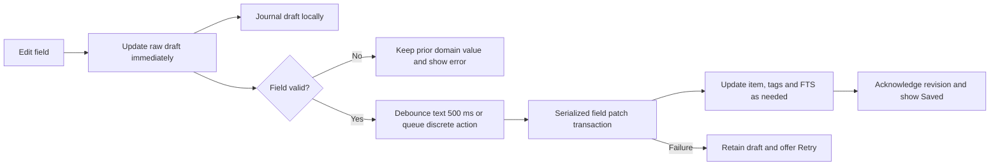

# 3. Screen redesign and Compose specifications

[Design index](README.md) · [Audit](01-ux-audit.md) · [Tokens](02-design-system.md) · [Roadmap](04-roadmap.md)

All layouts below are proposed. Wireframes show hierarchy, not pixel-accurate output. Dimensions refer to dp; type sizes use sp. At normal scale, target the first useful action within the initial viewport of a 360 × 800 dp phone. At larger text sizes, allow content and actions to wrap and scroll.

## Shared app shell and interaction contracts

Keep Today, Collections, Vault and Discover as the four main destinations. Use `NavigationSuiteScaffold` for bar/rail switching. The shell owns one capture host, one action-feedback host and a modal coordinator. Screen content exposes action callbacks rather than starting independent copies of capture/reflection sheets.

The main top bar retains Search, Inbox and Settings, with Inbox count semantics. On narrow windows, put the greeting in Today content and use a short Today app-bar title so three 48 dp actions fit. The content greeting is shown once. The Inbox badge is a destination cue; the conditional Today pill is a temporary call to act and can be dismissed.

The global `+` always opens Quick Capture on the four main destinations and collection contents. In a collection it starts with that collection selected. Long press launches voice, with the accessible action “Voice capture.” Show a one-time, dismissible tooltip after opening capture: “You can also hold + to speak.” Keep a labeled mic inside capture permanently. Do not show the FAB over an open sheet or keyboard editor. Local actions such as New collection, New note and New fact remain labeled controls in their own content headers.

Back closes the active popup/sheet, then handles pane/detail navigation, then destination navigation. Preserve list position, view mode, filters and draft state when returning. Only one modal surface owns focus. A completion event from a draw sheet must hand off to reflection rather than stacking two bottom sheets.

All mutations return an operation result to the shared feedback host. State is updated after repository acknowledgement, or optimistically with a defined rollback. Ignore duplicate taps while an operation is committing. Snackbars carry an operation ID so Undo reverses the intended operation and never a later unrelated change.

### Reversible actions

Archive, file/move, major workflow transitions, reminder changes and metadata application show a concise snackbar with Undo. Ordinary typing and favorite toggles do not produce repeated snackbars. Favorite/rating controls remain directly reversible.

For file/move, retain the prior collection, status, completion timestamp and reminder state per item. Undo restores only the affected fields if their expected post-operation values still match; never overwrite a newer user edit. Restore the reminder through the same scheduling mechanism as a normal reminder edit.

For delete, add a durable pending-deletion boundary before using gesture deletion. Retain the item, tags, knowledge links, history and owned cover until the Undo window expires. Filter pending deletions from lists, search, draw candidates, widgets, notifications and normal exports. Suppress reminders while pending; reconcile on Undo. Cleanup after expiry can run at next launch/background work; it must never depend on an in-memory timer firing. Reuse the repository's full hard-delete cleanup only at finalization. A pending-deletion ledger requires a Room migration and query coverage.

Use a proposed 8-second Undo window extended by Android's accessibility timeout recommendation. New gestures may coalesce into one clearly labeled batch, such as “3 items filed,” with the full ID set retained. Do not silently discard a previous Undo opportunity when a second snackbar arrives.

## Today

The screen answers “What needs me now?” before offering reading or random discovery.

```text
Today                             Search  Inbox  Settings
Good morning
Friday, Nov 6
[ 2 captures to file     Review                  Dismiss ]

Due soon                                      View all
Arrival          Overdue · today 9:00
                 [Complete] [Snooze]
Dune             Tomorrow 18:00
                 [Complete] [Snooze]

Up next                                       View all
Kyoto            Planned              [Resume] [Complete]

MORNING FACT                               [Next fact]
“Octopuses have three hearts and blue blood.”
Marine biology                            Favorite  More

[Dice] Pick something for me
                                            [+]
Today       Collections       Vault       Discover
```

Use `Scaffold` → `LazyColumn` with keyed sections. Task rows use a compact reusable `ActionableItemRow`; editorial content uses a low container and serif `editorialFact`. Avoid an elevated full card for every task. The Inbox pill uses a neutral/secondary tonal surface, 48 dp minimum height, a direct Review action and a labeled dismiss target; it grows at large font size.

Order reminders by overdue first, then due time. Preserve the existing 48-hour horizon initially; refresh eligibility when the screen resumes and at the next due/horizon boundary using the injected clock. Show at most three and a total count. Deduplicate items from Up Next if already visible in Due Soon. Filter archived, pending-deleted and terminal items. Empty Due Soon disappears; empty Up Next is one helpful line, not an empty card.

Complete resolves the owning collection's DONE role and calls the existing status logic with `requestReflection = true`. If the schema lacks DONE, offer Change status instead of fabricating completion. Snooze opens a compact anchored menu/sheet with In 1 hour, Tomorrow 9:00 and Choose date/time. Calculate “Tomorrow” in the device's local timezone, handling DST through the app clock/time helpers. Show the resulting date/time and Undo. Preserve Android exact/approximate alarm behavior.

Resume opens the saved destination link when it is a safe supported link; otherwise it opens Item Detail focused on Quick Notes. It does not record an invented reading/watch session. Complete remains a separate direct action. Custom schemas use their role mapping throughout.

Morning Fact shows an eyebrow, at most three lines of quotation at normal scale, source and one Next fact action. Tap the quotation to open the complete fact. A horizontal swipe cycles to the next fact, with a visible Next alternative; respect horizontal intent so vertical scrolling remains reliable. Share and other less frequent actions move to More; Favorite can remain a 48 dp icon. Preserve the existing daily rotation, hidden-fact exclusion and learned-fact weighting. No facts produces an Add fact text action in the compact reading area.

Replace the four-button Surprise block with one lightweight Pick something for me row. It opens the shared draw experience immediately with default eligible items. Context selection and advanced preferences live in Discover. With no eligible items, offer Add an item rather than animating a failed draw.

`TodayViewModel` adds direct Complete/Snooze commands and a derived deduplicated presentation list. Completion and scheduling remain repository/domain responsibilities. Greeting/date are derived from the app's injectable clock and locale, rather than separate untestable wall-clock calls.

## Quick Capture

Open a `ModalBottomSheet` with focus in the text field and the IME visible. Keep text, preview, suggestions and Save within the keyboard-adjusted visible area. On short landscape windows use a full-height capture surface; on expanded windows use a centered sheet capped at 640 dp width.

```text
Quick capture                                    [Mic]
[ Watch Arrival  #scifi  !high                        ]
  normal title   token   token
Will save to [Movies ▾] · [#scifi] · [High]

[Collection]  [# Tag]  [! Priority]  [Voice]
[Cancel]                              [Save to Movies]
------------------------------------------------------
Android keyboard
```

Use one `TextFieldState` as the raw-text/selection/composition source. Build a parser presentation model with semantic values **and original source ranges**: title, inferred collection, explicit override, tags, priority, link and unresolved tokens. UI highlighting, preview and saved output must use the same parser result; do not maintain an independent regular expression that can disagree with saving.

For `Watch Arrival #scifi !high`, the raw text remains editable, the title resolves to Arrival, Movies is inferred, #scifi uses a secondary-container span, and !high uses a tertiary/priority span. A token retains its literal characters while the caret is inside it. Highlight only recognized complete tokens; `!h` is an incomplete draft, not High. IME composition, selection, paste and Backspace remain normal text behavior.

Prefer visual-only styling through `OutputTransformation` and range spans when the resolved API supports it. Android documents state-based input and display transformations in [Configure text fields](https://developer.android.com/develop/ui/compose/text/user-input). The newer [rich-input guide](https://developer.android.com/develop/ui/compose/text/rich-text-input?hl=en) documents `addStyle` and its required Foundation/Material versions. The cached Material 3 1.4.0 must not be assumed to support the newest styled Material field: use a Foundation `BasicTextField` with an app decoration and supported output styling after a compilation spike, or retain `VisualTransformation` + identity offsets for same-length highlighting as the compatibility path. Real rounded tokens can also be drawn behind unchanged glyph ranges; do not replace text with embedded interactive composables that break editing or accessibility.

The preview uses actual interactive chips. Tapping Movies opens a collection picker with Auto-detect, Inbox and searchable collections. A manual choice wins over `@collection`, which wins over the leading verb. Show Manual when overridden; returning to Auto-detect restores inference. Explicit Inbox stays Inbox. The preview always reflects the final destination, not just the parser's suggestion.

The app-owned suggestion strip sits directly above the IME, inside the capture layout; it does not replace the Android keyboard's suggestion row. Its four controls remain present without needing horizontal discovery at standard phone widths. Tag opens recent/known tags and a create option; Priority opens None/Low/Medium/High/Urgent; choosing either inserts or replaces the relevant token at a stable selection. Do not append a second contradictory priority token. Collection override is structured state, so collection names containing spaces need no special typing. Voice returns a transcript into the current selection; never silently erase existing capture text.

Use a semantic-chip control outside the raw text to edit/remove a parsed tag or priority. The parser must return range information so removal affects only the intended occurrence and whitespace. Unresolved `@name` shows “Collection not found” with Choose collection; do not silently discard a user's text and pretend a destination matched. Define and test literal-marker escaping before changing existing parser behavior.

Save and IME Done call one guarded command. Disable for blank parsed title or while committing; show a local field error for a line containing tokens only. Preserve a typed draft if saving fails. Dismiss only after the Room transaction succeeds; then show Saved to Movies with Undo. Keep the draft on accidental sheet dismissal and restore it next time; expose Clear draft as an explicit action. A normal capture should need only typing plus one Save.

Mic has idle, launching, returned, cancelled and unavailable states. Keep typed text on recognizer cancellation or failure. The recognizer requests offline processing as today, but the UI promises only “Use your device's speech service,” since an installed service determines actual processing. Respect App Lock before launching voice from a FAB, launcher shortcut, share target, tile or widget.

Android Share capture reuses the same parser/preview and destination picker. Its existing Item/Note/Fact choice remains available; preserving shared title/URL and a one-tap Save take priority over syntax education.

## Inbox

```text
Back   Inbox · 12                              [Select]
Swipe right to file · left to delete        [Customize]

Read The Left Hand of Darkness
#fiction · Captured today
[Books ✓ suggested]  [Recent collection]  [Other…]

Call the dentist
Captured yesterday
[Tasks · recent]                           [Other…]

Selection mode:
Close   6 selected                        [Select all]
[checkbox] Item …
                           [File 6 items] [Delete]
```

Use `LazyColumn` with stable item IDs and compact cards/rows. Rank suggestions entirely on device: explicit capture hint/category first, then the user's recent filing destinations, then collection display order. Distinguish Suggested from Recent so a recent collection is not presented as a confident inference. Display at most two candidates plus Other. With no useful inference, the default filing gesture opens the picker rather than guessing.

Default start-to-end swipe accepts the visible top suggestion. End-to-start swipe deletes with Undo. Describe directions visually for the current locale; in RTL, start/end mirror. Show the actual destination name or Delete on the revealed background. Activate only after a deliberate threshold, initially 35% of row width, and use one haptic when crossing it. Allow Cancel before release. Settings → Interactions → Inbox gestures offers File suggestion, Choose collection, Delete or None for each direction. Existing on-card filing and an accessible Delete menu remain alternatives.

Use `SwipeToDismissBox` or an equivalent supported anchored-drag wrapper; handle its settled transition once and send one command with an operation ID. Do not mutate the repository from drawing/composition callbacks. A row leaves the visible list after a successful operation; on failure return it to rest and expose Retry. Every swipe action is also a TalkBack custom action.

Select button or long press enters selection mode. Keep selected IDs in ViewModel/SavedStateHandle, not selected row indices. Checkboxes replace swipe interactions. Select all means all items in the current Inbox, and its count is shown before committing. File opens one picker and applies one transaction to the selected IDs still in Inbox; stale items changed elsewhere are skipped with a truthful “5 filed; 1 already moved” result. If a target collection vanishes, keep the selection and ask for a new destination.

The repository already accepts ID lists, but currently chunks moves without an encompassing transaction. Add a transactional batch boundary and recheck target/status validity. Undo stores each item's prior state. Batch delete uses the pending-deletion model above and clearly states the count. Completing triage shows a quiet Inbox zero state with no pressure to fill it again.

## Item Detail

Use one editing model across text, tags, metadata, status, rating, priority, favorite, reminder, collection and cover operations. Keep provider search as a staged external operation; Apply becomes one explicit edit in that same model.

```text
Back   Movies                         Saved on device  More
┌ small cover ┐ Arrival                              [★]
└─────────────┘ [Movies ▾] · 2016 · 116 min

[Watching ▾]                         [Mark watched]
[Rating 4.5]  [Priority High]  [Reminder Tomorrow]

Quick notes
[ What would you like to remember?                    ]

Details                                     [Expand ▾]
Runtime 116 min · Year 2016 · Genre Science fiction

Cover & online details                      [Find details]
Link & tags                                  [Expand ▾]
Reflections · 2                              [Expand ▾]
“The story made me think about…”

Added date · Last updated · Completion date
```

The first region uses a compact 56–72 dp cover, an editable title and collection chip. Avoid a full-width cover above workflow actions. A tappable current-status chip opens all custom statuses; place the next meaningful action beside it. For BACKLOG, Start selects `schema.startStatus`; for ACTIVE, Complete uses `completionStatus`. With no corresponding role, show Change status. Never advance a DROPPED item or skip arbitrary intermediate custom statuses without showing the selected destination.

Below it, a wrapping action group presents rating, priority and reminder. Rating opens an anchored control with half-star increments, a numeric value, Clear and accessible increase/decrease actions. Priority opens the five named levels; do not compress them into a five-wide segmented row at large type. Favorite remains in the hero with state semantics. Quick Notes is the existing description field, initially two lines, growing on focus. It is separate from completion reflections, which are linked Vault notes.

Primary actions and the Quick Notes entry should fit the first normal-size phone viewport; this is not a fixed-height constraint. Use a `LazyColumn` of reusable sections, stable keys and `BringIntoViewRequester` for focused fields. Details is expanded when it contains an error or when entered via a metadata task; otherwise show a readable summary with progressive disclosure. Reflections shows a latest excerpt and count even when collapsed. Link & tags is a compact card rather than a long sequence of empty outlined controls.

### Unified autosave contract

Move all editable draft state into a single editor ViewModel/coordinator, keyed by item ID. `MetadataEditor` becomes a stateless field group and `ItemEnrichmentViewModel` stops owning independent writes. Keep raw numeric text distinct from `ItemMetadata` until it validates. The domain entity is the last committed valid state; the editor draft also holds per-field dirty/error/revision information.



Use a serialized writer/command queue. Debounce the production of a text patch, not an in-flight database transaction. A new keystroke must not cancel a committed operation or let an older completion acknowledgement clear a newer dirty value. Merge incoming Room values only into clean fields; compare acknowledgements to their submitted field revisions. Preserve unknown metadata JSON keys through the existing merge codec. Patch metadata fields against the latest database value instead of saving a stale complete snapshot.

Valid fields may save independently while another field is invalid. For example, author can save while page count is `-` or `12x`; the last valid page count remains in the canonical record. Blank optional numeric input deliberately clears it after debounce; invalid nonblank input never silently becomes null. An empty required title stays as a visible draft error and retains the last saved title. Validate ranges using the existing domain rules, plus localized decimal input for prices/coordinates. Use appropriate integer/decimal keyboards without rejecting normal paste or negative coordinate drafts.

Propose a private Room draft table with additive migration from schema 2, storing raw field values and revisions. Journal updates promptly (target 150 ms coalescing), flush on controlled Back and background transitions, and recover on next open. `SavedStateHandle` handles UI restoration but is not the only durable store. Forced termination before a write acknowledges can still lose the latest keystrokes; never show Saved for unacknowledged data. Drafts share App Lock protections, are excluded from search/widgets/ordinary exports, and are removed when an item is permanently deleted. Encrypted backups initially contain committed records; unfinished edits remain explicitly drafts on this device.

| State | Presentation | Behavior |
| --- | --- | --- |
| Clean | Small check + Saved on device | No snackbar; spoken feedback stays quiet |
| Queued/writing | Saving… after 300 ms if still pending | Keep fields interactive; do not flash on every key |
| Invalid field | Specific supporting error + Some edits need attention | Save other valid fields; expand error's card |
| Storage failure | Couldn't save · Retry | Keep draft, never claim success; provide an explicit leave-with-draft path if navigation cannot flush |
| Recovered draft | Draft restored | Show unresolved fields and continue editing |
| Item removed elsewhere | Item is no longer available | Stop queued writes, retain recoverable text for copying if appropriate; never recreate the item silently |

Flush eligible edits before controlled navigation and before Apply/move/delete operations. `ON_STOP` is best effort and must not be the only persistence path. Keep application-scoped persistence long enough to acknowledge queued writes independently of a removed composable; do not use arbitrary unbounded `NonCancellable` network or UI work.

### Metadata disclosure and enrichment

| Category | Summary shown when collapsed | Expanded fields |
| --- | --- | --- |
| Movies | Year · runtime · service | Runtime, release year, genre, streaming service, rewatch count; director after model/provider extension |
| Books | Author · pages | Author, pages, ISBN |
| Places | Address · cost tier | Address, opening-hours note, cost tier; coordinates in a nested Location group |
| Things to Buy | Price + currency · budget | Price, budget, currency, store link |
| Custom/generic | Time needed · price | Existing generic runtime/price/budget fields |

Keep Find book/movie details visible with lookup disabled. Tapping it presents:

> **Find book details online?** Your search text will be sent to Open Library. Personal notes stay on this device. Cover images download only if you select them.
>
> **Enable & search** · Keep editing offline

Name TMDB for movies. The primary action enables the existing persisted lookup setting and starts this search only after that update succeeds. Explain that future searches remain user-triggered and the setting can be turned off in Privacy & metadata. A declined sheet sends no request. With lookup already enabled, Search runs directly. For missing TMDB credentials, collect the API Read Access Token in the same contextual setup surface, storing it via `PrivateSecrets`; a one-tap consent cannot remove this provider prerequisite. Cancel leaves the item/draft intact.

After selecting a result, fetch the full provider details and build the diff **before** Apply. Small windows use stacked Current → Incoming rows; wide windows can use two columns. Show source, title/year identity, field-level changes and cover thumbnails. Each row is Fill, Replace or Keep mine. Default Fill for empty fields and Keep mine for populated fields. Cover download is off by default; replacing a local cover needs an explicit selection. Title and personal notes appear as Kept, without replacement checkboxes. Preserve tags, status, rating, priority, favorite, reminder, collection, personal service and rewatch count.

Example preview: Runtime “Not set → 116 min” selected; Genre “My genre → Science fiction” unchecked; Title “My Arrival notes — kept”; Notes “Your notes — kept.” The primary action reads Apply 2 changes. No meaningful changes disables Apply with an explanation. Provider fields missing from a response never clear local values.

Apply sends a single metadata patch through the editor coordinator and shows Updated 2 details · Undo. If local fields change while a preview is open, rebase the diff and require renewed selection for conflicts before applying. Cover retrieval runs as a separate bounded operation; retain the previous local cover until a replacement is fully imported. A failed cover download must not undo successfully applied metadata, and the result says Details updated; cover unavailable · Retry cover. Keep old cover files until Undo expires and they are no longer referenced.

Offline, cancellation, timeout, no results, provider authentication failure and disabled-consent changes each retain manual editing and the existing draft. Never start provider or cover requests just by opening detail or typing a title.

## Collections: overview and shared controls

Keep the overview as a compact adaptive collection grid, with icon/name, unstarted/in-progress counts and a readable completion summary. Distinguish Active role count from all unfinished items; the current generic “active” wording can be misread. Put New collection in the header, leaving the global FAB for capture. Empty collections remain visible and offer Add first item.

Collection contents share one `CollectionDetailUiState` across List, Grid and Board. Preserve filter/sort selection, first visible item and view mode per collection. Use a top bar with title, item count, Filter and More; expose List/Grid/Board as the current segmented view chooser. Show at most a few active filter chips below it, with Clear and a Filter sheet for the complete status/tag/favorite controls. The sheet also contains sort field/direction. A summary such as “12 shown · Priority ↓” makes hidden state understandable.

Avoid moving a card immediately under a finger when a sort-changing edit completes; animate it after the action settles and keep Undo visible. Zero items offers capture; zero matches offers Clear filters without suggesting the collection is empty. Use stable keys and content types in lazy containers, bounded image sizes and cached local covers. No collection view initiates online art retrieval.

### List

```text
Movies · 18                         Filter   More
[List ✓] [Grid] [Board]       12 shown · Priority ↓
[Watching ×] [#scifi ×]                      Clear

[cover] Arrival                         [Favorite]
        [Watching ▾]  116 min  2016  4.5 / 5
        High priority · #scifi
```

Use `LazyColumn` with 80 dp minimum rows, 16 dp gutters and a 40 × 60 dp movie/book thumbnail. For uncatalogued art, use a small typographic tile rather than the same large category icon on every row. Give the title up to two lines; show an independently wrapping line of status, essential category metadata and numeric rating. A third line contains priority/tags only when useful. At large type all lines expand.

Movies prioritize runtime/year; Books author/pages; Places locality/cost tier; Shopping price/currency/budget. Omit missing values instead of printing dashes across the list. Never truncate the amount or unit. A status label is an actionable chip; favorite has a separate 48 dp target with toggle semantics.

Start-to-end swipe previews the next status and commits on deliberate release. Use the next configured status in the collection's order, showing its exact name. Stop at terminal states; do not cycle a completed item back to backlog. If advancing into DONE, show completion feedback then the optional reflection prompt. Accessible Change status provides all destinations. Undo restores completion/reminder effects as well as the status key.

### Grid

Use `LazyVerticalGrid` with a proposed 152 dp minimum card width; a 360 dp phone fits two columns with 16 dp gutters and a 12 dp gap. Narrower widths or large type can use one column. Increase columns from available pane width, not total device width.

Movie posters and book covers use **2:3** media bounds. Place and shopping imagery use **4:3**; generic/custom collections default to **1:1**, with a future per-collection option only if necessary. Keep cover bounds consistent within a collection. Text is below the image on an opaque theme surface, not inside a cover whose aspect ratio also constrains the title.

Missing art shows the item title as intentional typography, a small collection marker and a stable tonal variation; failed local image loads fall back to that design. Status and numeric rating wrap below the title. A favorite badge over art sits on an opaque tonal disc with a contrasting icon. Do not put a five-star row beside a long custom status in a fixed-width row.

The same item/cover key powers Grid → Detail shared bounds in Phase 4. List thumbnails can use the same logical key, with only one active source view participating at a time. Restore source scroll and image position on Back. Use a fade if the source item is filtered out, moved or no longer visible.

### Kanban / Board

```text
Movies      [List] [Grid] [Board ✓]
┌ Want to watch · 12 ──────────┐  ┌ Watching · 3 ───
│ Backlog                     │  │ In progress
│ Arrival                     │  │ Dune …
│ 116 min · High               │  │
│ [Want to watch ▾]            │  │
└─────────────────────────────┘  └──────────────────
             lane peek →
```

Use a horizontal `LazyRow` with `rememberSnapFlingBehavior` for a supported lazy-list API. Phone lane width starts at `availableContentWidth - 40.dp`, clamped to 260–340 dp; retain a next-lane peek. On wider panes use 300–360 dp lanes with more than one visible. Keep each lane's header and role caption visible above its own `LazyColumn`. Show custom name, count and role, e.g. “Watching · 3 / In progress.” Keep the existing Other safety lane for unknown status keys.

Cards show title, one metadata line and the **current-status chip**, which opens a destination menu in one tap. Menu destinations use custom labels and role icons; changing status remains a second intentional tap. This is the primary one-handed move path. Drag is an enhancement, not a requirement to use Board.

Long press on a drag handle/card region starts an in-app drag with pickup haptic, 1.02 scale, stronger outline and tonal elevation. Highlight valid lanes; auto-scroll near the horizontal/vertical edges with a capped speed and pause snapping during drag. Drop sends one status command; cancel/outside drop restores the original position. Do not persist on every hover. Keep vertical scrolling and horizontal lane swiping distinct through touch slop and drag handles.

Use supported pointer-input and drag primitives; Compose's [drag documentation](https://developer.android.com/develop/ui/compose/touch-input/pointer-input/drag-composables) describes gesture detection and state handling. A custom cross-lane controller must own hit testing, autoscroll, cancellation and TalkBack alternatives. This deserves its own implementation/test task; a `graphicsLayer` translation alone is not a complete reorder system. Board sorts stay explicit; this proposal moves statuses and does not add persistent manual ordering within a lane.

## Vault, reflections and history

Keep Notes and Facts as a two-way segmented selector, restoring separate filters and scroll positions. Each tab has a labeled local New note/New fact action. The global capture FAB keeps its shared meaning. A reading surface can use a slightly wider gutter and serif excerpts without changing operational controls.

### Notes

Group pinned notes first under a small Pinned heading, then All notes ordered by updated time. Use a `LazyColumn` of mostly unboxed editorial rows: title, two/three-line excerpt, tags and relative update time. Pinned state uses icon plus accessible text and a menu alternative. Long titles wrap; the note body uses normal body text in its editor. Show linked-item context as “Reflection on Arrival” so a completion note is distinguishable from a general note.

Tag filters show active tags and a Filter action rather than an ever-growing wall of chips. Empty Notes offers Write a note and explains local storage briefly. A no-match state offers Clear filters. Note and fact editors retain their existing save-on-leave behavior until the unified coordinator pattern is deliberately extended and regression-tested; avoid claiming they have Item Detail's new draft model automatically.

### Facts

```text
Vault                         New fact
[Notes] [Facts ✓]        [Draw a fact]
[Reviewing ×] [Animals ×]                 Filter

FACT · Animals
“A group of flamingos is called a flamboyance.”
Source: Wikipedia
[Reviewing · 2 of 3 ▾]       Favorite  More
```

Use a 24 dp rounded editorial fact card on `surfaceContainerLow`, with a readable source label/link, topic, optional commentary preview and a persistent mastery chip. Facts have a quotation-first hierarchy; Notes have a title/excerpt-first hierarchy. Do not place large share buttons on every card when More can contain Share.

New → Reviewing → Learned is a qualitative three-state progression. The mastery chip opens a clear menu and shows the current position textually. Hidden is a separate action labeled Hide from rotation; it can be reversed from Filter → Hidden. The random fact draw excludes Hidden and honors existing mastery weighting. Filter controls offer topic/source, tags, favorites and mastery with a selected-count summary.

### Completion reflection

Commit completion first, provide the completion check/haptic, then hand off to the optional reflection sheet after approximately 200 ms when motion is enabled. The user can dismiss immediately and the item stays completed. Respect a preference to stop prompting; offer Add reflection from Item Detail later.

Keep the existing prompt “What stood out?” and show item title plus date. Save reflection as a linked Vault note with inherited tags through `KnowledgeRepository.reflect`. Persist unfinished reflection text as a recoverable draft if the user dismisses after typing. Do not create an empty note. Undo completion cancels its pending reflection prompt; a note already saved is retained and remains editable rather than silently deleted.

Queue reflection requests by completion event instead of overwriting a single global request. Deduplicate repeated DONE changes and do not prompt when a save acknowledgement or configuration restoration replays. Batch completion offers one “Add reflections later” feedback action rather than opening a succession of sheets.

Item Detail's Reflections card shows the most recent excerpt, date and count, with View all and Add reflection. History groups selection events by date and shows action, collection and linked reflection excerpts for completed items. The present link model associates notes with items, not a unique completion event. Initially label these **Item reflections**, avoiding a claim that a note belongs to a specific repeated completion. If exact completion-cycle history becomes necessary, add an explicit completion-event relation and migration/transfer support as a separate scope.

### Insights

Put the headline activity summary and a compact monthly chart above the backlog action area. The chart has a plain-text summary and accessible month values; twelve verbose explanation rows need not precede actionable cleanup. Keep the current cohort-based completion-rate definition available through an Info affordance.

Rename the user-facing graveyard area **Still interested?** with “Unstarted for more than 90 days.” Each row offers Archive and More → Let go; a Roll now action draws from that exact eligible backlog subset. Archive is reversible, preserves records/history and is available in batch. Let go means delete and uses the reversible deletion boundary, with a count confirmation for a large batch. Show both meanings plainly; never use Let go as a euphemism without explaining deletion.

Use the injected clock and `BACKLOG` role for age eligibility. Recheck the IDs when acting, as the existing archive method already does. Preserve items that have since started/completed. Roll now passes the same cutoff/role/collection set to Discover; it should not silently include all old records or reset the user's permanent filters.

## Discover

Lead with a choice someone recognizes, then let them refine it. Advanced controls remain available but do not fill the landing viewport.

```text
Discover                           Search Inbox Settings
What fits right now?
[Quick ≤30m] [Free] [High priority] [Unstarted >90d]
[Books ×] [#scifi ×]                     [Filters · 2]

             [Roll from 18 matches]

YOUR PICK
[cover] The Left Hand of Darkness
Books · Unstarted · 304 pp
[Start reading] [Complete] [Roll again · 17 left]
Details                                    History
                                                [+]
```

Use `Scaffold` → `LazyColumn` with headline, wrapping preset group, active-filter summary, draw CTA and a keyed result region. Put the initial CTA above the result region; after a draw, keep the compact result's actions close to it and avoid jumping back to the filter header. `AnimatedContent` can update the result by item ID, preserving scroll for phase changes on the same item. At large text sizes, actions stack vertically. An always-visible local CTA must not collide with the global FAB.

| Preset | Exact filter patch | Unknown metadata |
| --- | --- | --- |
| Quick ≤30m | `maxRuntimeMinutes = 30` | Excluded; explain “Items with saved duration” |
| Free | `maxPrice = 0`, nonnegative known price | Missing price is not free |
| High priority | `minPriority = HIGH` (includes Urgent) | Priority None does not qualify |
| Unstarted >90d | `unstartedOnly = true` and strict `createdAt < cutoff` | Uses BACKLOG role and injected clock |

Presets toggle independently and combine with AND across dimensions. Tags keep the existing any-of semantics. Store a preset's previous values so toggling it off can restore its own fields; a manual change to one of its fields clears that preset's selected badge and owns the new value. A compound preset updates atomically, so the live count does not flicker through an intermediate pool. Quick uses ≤30 minutes, matching the filter, rather than promising strictly less than 30.

### Advanced filter sheet

Use a `ModalBottomSheet` with scrollable filter groups and a sticky footer. Every change updates a **draft filter state** and live count; the footer reads Show 18 matches. Apply commits those filters and dismisses; Cancel restores the prior applied filters. Reset clearly resets the draft. Persist applied filter choices through resize/navigation; the temporary sheet draft may be restored if the app recreates it.

| Dimension | Control and semantics |
| --- | --- |
| Collection | Searchable collection picker; Any collection by default |
| Status | Not finished / Not started / Any status; derived from roles, not labels |
| Tags | Searchable multi-select; labeled Match any selected tag |
| Favorites | Toggle with explicit state |
| Priority | Any / High and Urgent, with the selected rule named |
| Cooldown | 0/1/3/7/14/30 days; current configured set retained |
| Time available | Any or maximum minutes; show missing-duration exclusion |
| Price | Maximum amount with an explicit currency; missing price excluded |
| Age | Any / Last 30 days / Older than 90 days; precise boundary and clock shared with count/draw |

The existing price filter compares raw values without currency. Add an explicit currency constraint before presenting paid maxima across collections. Do not compare USD 25 with JPY 25 as if equivalent and do not add live currency conversion to an offline feature. Free can include any currency with a known zero price. Show a helpful count of items missing the constrained field and a link to edit them, without silently relaxing the filter.

### Pool and session contract

Derive applied filters, current time, current records and skipped IDs in a shared domain pipeline. Use the same eligibility function for preview count and draw, then revalidate immediately before committing a selection. Always exclude Inbox, archived and pending-deleted items. Not finished excludes DONE and DROPPED; Not started selects BACKLOG; Any status may include DONE/DROPPED but still excludes archived items.

Expose `eligibleCount` and `remainingCount` separately. Initially Roll from 18 matches means eighteen currently drawable candidates. After showing one, Roll again · 17 left excludes the current result and all skipped IDs. A line may say “18 match your filters · 17 other choices.” Do not reuse the old count that explicitly includes skipped records as the remaining count.

Roll again marks an unaccepted current pick SKIPPED and suppresses it for the active session. Preserve skipped IDs through rotation and filter changes within that session; intersect them with the current pool. Start over explicitly clears them. Ending the draw surface/session clears session skips; persistent selection history and configured cooldown remain. Use one selection job/action guard so rapid taps cannot duplicate history or apply Start to a result already replaced.

Start uses the collection's ACTIVE start role, with a contextual label such as Start reading or Start watching. If already active, label Resume and avoid rewriting its status. Without ACTIVE, use Choose status/Open item. Complete uses DONE when available and triggers the shared completion/reflection flow. After a successful action, keep a small confirmation on the same card with Open item and Pick another. Record history once per draw; accept/complete update that history entry rather than inserting accidental duplicates.

Reveal is a short, rewarding tonal/scale settle with cover/title, not a fake loading delay. Commit selection/history independently of animation completion. With Reduce motion or zero animator scale, reveal immediately.

| State | UI and recovery |
| --- | --- |
| Loading local pool | Brief neutral placeholder; never flash 0 matches before data loads |
| Zero eligible | Disabled Roll · 0 matches; Clear filters or Add an item, plus the specific restrictive rule when known |
| Session exhausted | You've seen every match · Start over / Change filters; no automatic repeats |
| One candidate | Roll from 1 match; after reveal, say No other matches instead of a misleading Roll again |
| Result changed/deleted elsewhere | Revalidate actions; explain Item changed and refresh pool without mutating another item |
| Database failure | Keep filters/result; show Retry without inventing a successful draw |

## Adaptive layouts

Use available window size and posture, not a tablet model check. Retain the existing navigation suite's adaptive behavior. Compact width below 600 dp uses the phone stack; medium 600–839 dp generally uses a rail and a constrained single pane; expanded 840 dp+ may use two panes when the remaining safe content width fits them. Check actual minima after rail/insets: list at least 280 dp, detail at least 360 dp, and a 24 dp gap. If they do not fit, stay single-pane. A short landscape window may still require stacked content or full-height sheets.

Android provides `ListDetailPaneScaffold`, `NavigableListDetailPaneScaffold`, pane navigation and posture-aware adaptation in its [list-detail guide](https://developer.android.com/develop/ui/compose/layouts/adaptive/list-detail). Add the compatible `adaptive`, `adaptive-layout` and `adaptive-navigation` artifacts explicitly; the current navigation-suite dependency alone is not an implementation of the content panes. Use the repository's existing typed Navigation Compose stack; a Navigation 3 migration is not required for this proposal.

| Destination | List pane | Detail pane |
| --- | --- | --- |
| Collections | Items in the selected collection, with List/Grid/Board controls | Selected item editor; show Select an item when none is selected |
| Vault | Note/fact list with the active segment and filters | Selected note/fact reader/editor |
| Search | Query, result type/filter summary and results | Selected item/note/fact, with query context preserved |
| Settings | Appearance, Capture & interactions, Notifications, Privacy & metadata, Backups, Insights | Selected settings group |

Keep collection selection in a header/picker; avoid requiring three panes on an ordinary expanded window. The rail remains visible while editing in a two-pane context. Each pane owns independent scrolling; the detail pane caps readable text width. Distribute panes around an occluding hinge using scaffold posture information; do not let a field, button or drag target straddle it.

Extract `ItemDetailContent(itemId, state, onAction)` and equivalent Vault editors from route-specific wrappers. Today the item ViewModel reads its ID from `SavedStateHandle.toRoute`; pane selection must pass an explicit ID or create a keyed editor instance through a factory. One shared unkeyed Hilt ViewModel cannot safely switch between records without rebinding drafts. The navigation adapter owns the current selected ID and one authoritative pane/back stack.

On item selection, commit/journal the prior editor's eligible draft, then display the next item. Preserve both drafts by ID. On compact → expanded resize, keep the selected record; on expanded → compact, show its detail with Back to the prior list position. Back in compact detail returns to the list; expanded Back follows the selected pane-navigation behavior and must not accidentally traverse every prior row selection. Test deep links, predictive Back, rotation and hinge posture before choosing the final navigator configuration.

## Settings, backup status and privacy surfaces

Settings groups use a consistent title, concise summary and local controls. Avoid placing backup passphrase inputs, setup explanation, schedule and restore on one undifferentiated long form. Separate setup/restore tasks from the compact ongoing status card.

The backup card shows a lock icon and state: Off, Setup needed, Scheduled, Saving, Last backup failed, or Saved to chosen folder. Include last successful local timestamp, chosen folder/provider label, configured interval and Back up now. Call the future time **Next eligible run**, since WorkManager/provider availability can delay it. The document provider's successful write is not proof that a cloud service has completed upload. On failure show Retry and Change folder as appropriate, retaining the last successful time.

Encrypted archive copy states that records and owned covers are included and the passphrase is required to restore elsewhere. Keep plaintext JSON/CSV/Markdown export labeling explicit. Do not describe App Lock as database encryption or folder backup as automatic two-way sync. Use the existing archive/SAF/Keystore architecture; cosmetic changes must not alter format or retention rules.

| Surface | Required locked/lock-enabled behavior |
| --- | --- |
| Main and auxiliary activities | Authenticate before composing private app content; no unlocked-content flash while preferences load |
| Recent Apps / screenshots | Preserve secure-window policy while App Lock is enabled, including capture/share activities and transition overlays |
| Fact widget | Keep the existing stricter policy: redact saved fact content whenever App Lock is enabled, even during an unlocked app session |
| Capture widget / shortcuts / tile | Show generic action labels; entering capture/voice/random requires authentication |
| Notifications | Generic title/body and safe public version under App Lock; no fact, item, reminder or tag text in actions/previews |
| In-app search/history/backup preview | Display private content only inside an authenticated surface |
| Restored drafts and Undo | Stay behind the same lock; never place draft text in a snackbar outside the protected activity |

Preserve the current biometric/device-credential model. Settings should say Use biometrics or device PIN rather than suggesting a separate Notes App PIN exists. Confirm that secure-window flags apply before private first-frame rendering and remain in effect during modal/shared transitions; this is a verification requirement, not a newly demonstrated leak. No lock-protected screenshot should be generated for the redesign tour.
