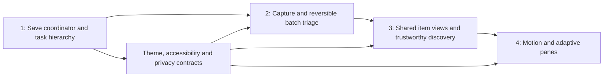

# 4. Phased implementation roadmap

Implementation records: [milestone 1](../redesign-milestone1.md) and [milestone 2](../redesign-milestone2.md). The current collection/discovery increment is recorded in [milestone 3](../redesign-milestone3.md). Milestone 4 includes the [adaptive foundation](../redesign-milestone4.md) and [motion, Board and quality pass](../redesign-milestone4-polish.md). The latest record distinguishes implemented behavior and emulator verification from the remaining physical-device, assistive-input and release acceptance gates.

[Design index](README.md) · [Audit](01-ux-audit.md) · [Tokens](02-design-system.md) · [Screen specifications](03-screen-specs.md)

These are four **redesign milestones**, separate from the implemented feature phases in the original product specification. Ship each as an independently useful increment, keeping persistence and domain behavior as the foundation for visual changes.

## Sequencing, impact and effort

| Milestone | User outcome | Impact | Planning range |
| --- | --- | --- | --- |
| 1. Quick wins and friction removal | Edits persist consistently; urgent actions are in reach; lookup can be enabled in context | Highest: trust and daily use | 12–18 engineer-days |
| 2. Core capture, syntax and Inbox triage | Capture needs less symbol typing; multiple items can be filed together; global capture is consistent | High: repeated capture/filing cost | 8–13 engineer-days |
| 3. Collection views, Discover and Item Detail polish | Collections scan well; a decision takes one preset and a draw; metadata changes are reviewable | High: choosing and maintaining a collection | 14–22 engineer-days |
| 4. Motion, AMOLED refinement and adaptive layouts | Transitions preserve context; large windows show useful panes; all themes and input modes hold up | Medium overall; high for large-screen/accessibility users | 12–20 engineer-days |

Ranges are initial engineering estimates for one experienced Android engineer familiar with this codebase, with product-design review and QA available. They include focused regression work and additive migrations, but not a backend, two-way sync, a separate app PIN, or a wholesale navigation-library migration. They are not delivery commitments. Autosave is the largest part of milestone 1 and should not be presented as a cosmetic quick fix. Re-estimate it after the persistence/API spike.



## Milestone 1 — Quick wins and friction removal

1. **Establish the dependency and behavior baseline.** Resolve the actual Compose/Material graph, compare it with the catalog, and compile a small supported input/pane/motion API probe if needed. Close the existing normal-installed-app smoke placeholder in `docs/verification.md` with real evidence before a release; do not reinterpret historical device counts as new results. Capture current mixed-edit behavior with synthetic data.
2. **Implement the unified editor.** Introduce an `ItemEditorDraft`, field patches/revisions, save-state model and serialized writer under `ui/item`. Convert `MetadataEditor` into a stateless field group. Route Item Detail and enrichment mutations through the coordinator. Add private draft persistence with an additive Room migration and preserve metadata extension keys. Maintain item/tag/FTS transactional guarantees.
3. **Add reversible major edits.** Capture previous affected values for status/move/archive/reminder changes and resolve operation IDs in a shared feedback host. Restore completion/reminder side effects on Undo. Keep existing confirmed hard deletion until the durable deletion boundary ships in milestone 2.
4. **Reorder and compact Today.** Put the dismissible Inbox pill first, then due/active rows with Complete/Snooze/Resume. Compact Morning Fact and replace the four quick-draw buttons with one action. Add clock-driven reminder refresh and deduplication between Due Soon and Up Next.
5. **Add contextual consent.** Keep Find details reachable while lookup is disabled; persist Enable & search before network access, collect missing movie credentials in place, retain the manual/offline path and query. The full diff UI follows in milestone 3.
6. **Lay down shared visual tokens.** Add explicit typography/shapes and common surface assignments. Fix meaningful rating/favorite contrast early. Add skeleton/loading and save-error states, without waiting for hero motion.

Primary files: `ui/item/ItemDetailScreen.kt`, `ItemDetailViewModel.kt`, `MetadataEditor.kt`, `ItemEnrichment.kt`, `data/repository/ItemRepository.kt`, `data/db/AppDatabase.kt`, `ui/today/TodayScreen.kt`, `TodayViewModel.kt`, `ui/theme/Theme.kt`, and `Color.kt`. New draft/operation types should have narrow responsibilities; do not create a general event framework for every screen.

**Release gates:**

- Edit title, tags, runtime/pages and notes; change status/priority while the debounce is pending; leave before 500 ms. Reopen and verify all acknowledged valid fields, tags and FTS content.
- Enter an incomplete number, edit another valid field and navigate away. Recover the raw draft without clearing the prior canonical number; show the specific error. Test controlled Back, background, rotation and recreation after a journal acknowledgement separately.
- Simulate storage failure and out-of-order save acknowledgements. The latest draft stays visible; Saved is never shown for failed/unacknowledged changes.
- Complete and snooze a due item without opening detail. Check custom status labels, no-DONE schemas, scheduling reconciliation and Undo.
- Decline lookup and prove zero provider requests. Accept and verify consent precedes the first request; missing TMDB token stays in the contextual flow. Manual editing works with airplane mode enabled.

Extend `EditorPersistenceTest`, `ItemRepositoryTest`, `ItemDetailScreenTest`, `TodayAndCaptureTest`, `Phase2RepositoryTest` and metadata fixtures in `Phase34RepositoryTest`. Add narrowly scoped coordinator tests with a fake clock/dispatcher; use them to test write ordering and failure recovery, not just that a callback was invoked.

## Milestone 2 — Core capture, syntax and Inbox triage

1. **Unify capture hosting.** Move the capture host/FAB to `NotesApp`, pass collection context explicitly, and add labeled New collection/New note/New fact actions. Keep launcher/share/tile/widget routes authenticated and use one capture command path.
2. **Expose parsing.** Extend `QuickCaptureParser` with source-range presentation data and explicit unresolved-token behavior. Add live styling, destination/tag/priority preview and the four-control suggestion strip. Preserve selection, IME composition and typed content when voice returns or cancels. Use the supported styling path identified in milestone 1.
3. **Rank Inbox suggestions.** Use local parser hints and recent filing destinations. Show why a collection is suggested. Add a full collection picker behind Other.
4. **Add reversible gestures.** Introduce the pending-deletion ledger with an additive migration, query exclusions and reminder/cover cleanup rules. Wire configurable swipe directions and matching accessible menu actions. Keep the row until an operation succeeds and restore it on failure.
5. **Ship selection and batch filing.** Store selected IDs, provide Select all and count-aware File/Delete actions, recheck stale IDs/target schema and wrap the ID-list move in a transaction. A single Undo reverses the committed batch.

Primary files: `ui/NotesApp.kt`, `ui/capture/QuickCaptureSheet.kt`, `VoiceCaptureButton.kt`, `domain/capture/QuickCaptureParser.kt`, `ui/inbox/InboxScreen.kt`, `InboxViewModel.kt`, `data/repository/ItemRepository.kt`, item/search DAOs, `ui/settings`, and the relevant query/export/automation paths. Add a small gesture preference model in DataStore.

**Release gates:**

- Type, paste and edit `Watch Arrival #scifi !high`, URLs, Unicode tags and incomplete markers; preview and saved values agree. Test collection override, duplicate priority choices, cursor-middle insertion and transcript insertion.
- Invoke capture from each main tab, a collection, Share and launcher entry points; `+` has consistent semantics and the right default destination.
- File ten mixed captures with one batch command. Delete and Undo an item with tags, cover, links, history and reminder; verify the complete graph survives. Force recreation during the Undo window and verify durable finalization/retention rules.
- Change a selected item's collection elsewhere and delete the target collection before commit. Batch results are truthful, transactions do not partially corrupt state, and selection remains recoverable.
- Perform every swipe operation with TalkBack/menu alternatives and check RTL direction mapping. Gesture personalization survives restart.

Extend `QuickCaptureParserTest`, `HintSummaryTest`, `TodayAndCaptureTest`, `DiscoverInboxSearchSettingsTest`, `ItemRepositoryTest`, `SearchTest`, `MigrationTest` and transfer tests that must exclude pending deletion/drafts. Add gesture UI checks for settled transitions and duplicate-tap protection; do not assert timing solely with sleeps.

## Milestone 3 — Collection views, Discover and Item Detail polish

1. **Build common item presentation.** Derive title/status/metadata/priority/rating display from one presentation model used in List, Grid, Board, Today and drawn results. Keep category-specific units and currency intact. Ship type-appropriate cover ratios and purposeful missing-art covers.
2. **Polish collection navigation.** Preserve per-collection view/filter/sort state, show active filters and match totals, add List swipe-to-advance and Board snap/lazy lanes. Replace Board's unlabeled move overflow with the current-status chip menu. Drag can ship in milestone 4.
3. **Rebuild Discover around presets.** Add preset patches, a draft advanced sheet, explicit currency constraints and a unified pool/count/session model. Separate eligible/remaining counts; exclude archive/pending deletion regardless of status mode. Add fixed-clock boundary rules and skip/history/action race handling.
4. **Stage enrichment changes.** Fetch complete details before a field-level diff. Apply selected patches with protected personal fields, conflict rebasing and Undo. Add `director` to the metadata model/provider mapping if this field is included in scope; update import/export, validation and search fixtures. Do not silently advertise unavailable provider data.
5. **Complete progressive disclosure.** Group Item Detail's structured fields, cover/lookup, links/tags and reflections. Keep primary workflow and Quick Notes early. Make error-containing groups open automatically.
6. **Differentiate Vault and close the review loop.** Ship editorial Notes/Fact treatments, a direct mastery chip, reflection excerpts in detail/history, and actionable Still interested? cleanup with Archive/Roll now/Let go. Queue completion requests and avoid forcing reflection after a batch.

Primary files: `ui/components/ItemComponents.kt`, `ui/collections/CollectionDetailScreen.kt`, `CollectionDetailViewModel.kt`, `ui/discover`, `ui/surprise`, `domain/random/PickRandomItem.kt`, `domain/metadata/ItemMetadata.kt`, `data/metadata/MetadataLookup.kt`, `ui/item`, `ui/vault`, `ui/history` and `ui/insights`.

**Release gates:**

- Discover draws without opening advanced filters. Verify all nine dimensions, preset combinations, tags-any semantics, known-zero Free, missing duration/price, mixed currencies and the exact 90-day boundary.
- Count equals the current drawable pool. Roll through it without repeats; distinguish zero matches from exhaustion; update history once per actual draw. Check rapid Draw/Start/Roll again and external item deletion.
- Preview fetched metadata, change the same field locally, then Apply. Custom title/notes/tags/workflow remain intact; conflicting fields require renewed choice. A failed cover fetch leaves the old cover and applied text details intact.
- Scan Lists and Grids at 200% font size with long titles/statuses. Essential numeric values remain complete and all actions remain reachable. Switch views and return without losing filters/scroll context.
- Complete via Detail, Today, swipe and Discover. Each yields one appropriate reflection request, one persisted state transition and correct reminder behavior. History labels item-linked reflections accurately.
- Roll from the 90-day backlog subset and recheck archive/delete eligibility at action time. Started records are preserved.

Extend `PickRandomItemTest`, `ItemListingTest`, `Phase34DomainTest`, `CollectionsScreenTest`, `VaultScreenTest`, `DiscoverInboxSearchSettingsTest`, `Phase2ScreenTest` and `Phase34ScreenTest`. Add fixture-based preview/conflict cases; live TMDB access is not required for deterministic correctness tests.

## Milestone 4 — Motion, AMOLED refinement and adaptive layouts

1. **Add content panes.** Add compatible adaptive layout/navigation dependencies; extract route-free content and keyed editor state. Implement Collections/Vault/Search/Settings list-detail panes with one navigation adapter, stable selected IDs and posture-aware widths. Keep the rail in expanded detail contexts.
2. **Add motion behind a small policy layer.** Shared cover bounds use one common transition scope; test source disappearance, back navigation and image loading. Implement FAB/capture handoff with a same-window transition host or matched visual handoff, preserving modal semantics. Keep immediate reduced-motion behavior.
3. **Add tactile Board drag.** Implement pickup, valid targets, edge autoscroll, cancellation, status commit and haptic deduplication. Keep the chip-menu path fully usable. No persistent within-column ordering is introduced.
4. **Finish theme consistency.** Audit every container, border, image overlay, snackbar and control in Light, Dark, dynamic and AMOLED. Apply explicit typography/shapes throughout; test multiple wallpaper palettes rather than one favorable dynamic scheme.
5. **Verify privacy through transitions.** Test secure flags, lock-before-content, widget redaction, notification content/actions, all external routes, restored drafts and capture/metadata overlays in the normal installed app as well as instrumentation.

Primary files: `ui/NotesApp.kt`, `ui/navigation`, route wrappers and content in `ui/collections`, `ui/item`, `ui/vault`, `ui/search`, `ui/settings`, shared motion/haptic adapters, `ui/theme`, and existing `security`/`launcher` surfaces.

**Release gates:**

- Resize between 360/600/840/1200 dp windows while editing; retain selected ID, acknowledged draft and list position. Test a hinge/occlusion posture, landscape height, compact deep links and predictive Back. Do not choose two panes when their minimum widths do not fit.
- Use TalkBack, keyboard navigation and switch-style focus to file/move/rate/edit/draw. Verify 200% fonts, RTL, long localized labels and high contrast system settings where available.
- Disable animator scale and enable Reduce motion. Every action still completes and focus lands predictably; no state commit depends on an animation callback. Check physical haptics on at least one device with system feedback disabled and enabled.
- Inspect true-black root regions numerically in the theme/preview and visually on OLED hardware if available. Contrast-check actual foreground/background pairs and functional icons, not just the token table.
- Lock from every relevant activity and enter through capture/share/widget/tile/notification routes. Check Recent Apps privacy manually. Keep lock-protected screenshots blocked and redact private notification/widget content even during an unlocked app session when the current stricter policy requires it.

Extend existing navigation/editor/widget tests and add targeted pane/resize tests. Refresh `ScreenTour`, `Phase2Tour` and `Phase34Tour` only for the final states they now cover. Use a short physical-device assessment for motion/haptics; emulator screenshots cannot validate those qualities.

## Verification and rollout discipline

Run the affected JVM/device suites during each milestone. Before integrating a milestone, run the project checks appropriate to its scope; before release, run the full regression/build/lint checks and normal installed-app smoke from the [project verification guide](../verification.md). Do not add overlapping test-run counts as distinct cases.

Typical Windows commands, using the project's configured JDK/SDK:

```powershell
# Establish actual API availability before changing dependencies.
.\gradlew.bat :app:dependencyInsight --dependency material3-android --configuration debugRuntimeClasspath

# Logic, compilation, lint, and full device regression at milestone integration.
.\gradlew.bat :app:testDebugUnitTest :app:assembleDebug :app:lintDebug
.\gradlew.bat :app:connectedDebugAndroidTest

# Final minified build before release runtime checks.
.\gradlew.bat :app:assembleRelease
```

Schema changes must have additive migration tests from the current schema, preserve existing records/unknown metadata keys, and define backup/import behavior for drafts and pending operations. Exported schema artifacts accompany their migration. A visual feature flag cannot make an older APK understand a newer database schema; rollback planning must account for storage compatibility. Avoid destructive migration fallbacks.

Keep screenshots and verification notes per redesign milestone in new folders so the existing captures remain a baseline. Record actual device/API, window size, font scale, theme, tests run and known limitations. Update the README's bulk-filing and save-model descriptions when behavior actually ships, not when this proposal is approved.

## Proposed product validation targets

These are targets for a moderated synthetic-data study and local performance measurement, not existing measurements or promises. Collect a baseline before the redesign; use the same task/data/device afterward. No new analytics service is implied.

| Task / quality | Proposed target | Method |
| --- | --- | --- |
| Capture a title into the inferred collection | One deliberate action after typing; median ≤5 s for the scripted example | Observe new users; include syntax-free picker use |
| File ten Inbox items into a chosen collection | One batch commit; median ≤20 s | Task observation including selecting a destination |
| Draw a suitable item | Preset + Draw, no advanced sheet required; median ≤10 s | Use a populated synthetic collection with known matches |
| Handle a due item | One Complete action or Snooze + one preset, without opening detail | Task observation; verify persistence afterward |
| Editing reliability | All acknowledged edits recovered; zero silent invalid-to-null conversions | Automated ordering/lifecycle/error cases plus manual smoke |
| Local response | Target visible feedback within 100 ms; valid autosave acknowledgement normally within 1 s after typing stops | Measure on a representative lower-performance supported device; separate I/O failures |
| Motion smoothness | No sustained frame-budget overruns during scroll/draw/cover transitions | Profile at the device's actual refresh rate with seeded realistic data |
| Comprehension | Users can explain where capture went, what metadata will change and whether edits saved | Brief task follow-up, including large-text/accessibility participants |

If a target fails, refine the interaction that causes the failure before adding motion. Release milestones only after their behavioral gates pass; theme and adaptive work should not mask a persistence or privacy regression.
